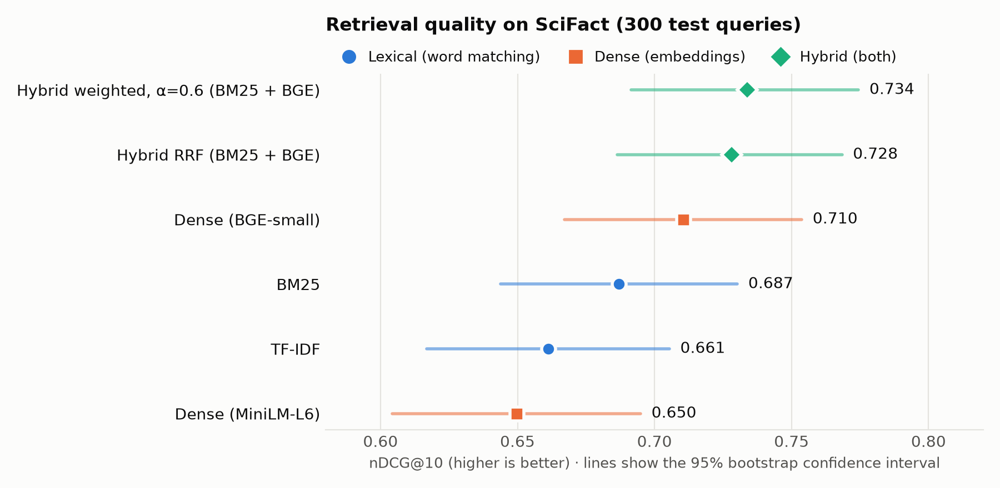
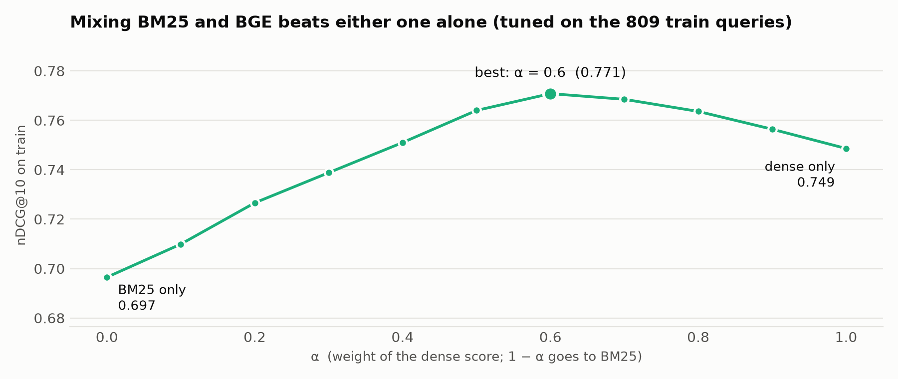

# Retrieval Eval Bench

Which retrieval method should a RAG system use? This benchmark compares **TF-IDF**, **BM25**, **dense embeddings** and **hybrid search** on a public, human-labelled dataset, scored with **recall@k, MRR@10 and nDCG@10**, with parameters tuned on a train split, results reported on a separate test split, and **significance tests** to separate real gains from noise.


<picture>
  <source media="(prefers-color-scheme: dark)" srcset="docs/ndcg_dark.png">
  
</picture>

## Key findings

1. **Hybrid search is best**: BM25 + BGE-small with weighted fusion reaches **nDCG@10 0.734** vs 0.710 for the best single method, a statistically significant gain (p = 0.013).
2. **BM25 is a strong baseline**: the small BGE model beats it by 0.023 nDCG@10, but that difference is **not significant** (p = 0.16) on 300 queries. A free, fast lexical method is competitive on scientific text.
3. **The embedding model matters more than "dense vs lexical"**: BGE-small beats MiniLM-L6 by 0.061 (p < 0.001), and MiniLM is even slightly below TF-IDF.
4. **The two methods fail on different queries**: BM25 wins on 57 test queries, BGE on 73. That is why combining them works.
5. **Stemming helps lexical search**: +0.020 nDCG@10 for BM25 and +0.014 for TF-IDF.

## Results

SciFact (BEIR), **test split: 300 queries, 5,183 scientific abstracts**. Settings tuned on the separate 809-query train split.

| Retriever | Recall@1 | Recall@5 | Recall@10 | MRR@10 | **nDCG@10** | ms / query |
|:--|--:|--:|--:|--:|--:|--:|
| TF-IDF (1–2-grams, stemmed) | 0.511 | 0.740 | 0.797 | 0.626 | 0.661 | 0.1 |
| BM25 (k1 = 1.5, b = 0.5) | 0.537 | 0.754 | 0.819 | 0.650 | 0.687 | 3.7 |
| Dense: all-MiniLM-L6-v2 | 0.489 | 0.731 | 0.788 | 0.610 | 0.650 | 0.7 |
| Dense: bge-small-en-v1.5 | 0.568 | 0.759 | 0.836 | 0.678 | 0.710 | 1.2 |
| Hybrid RRF (BM25 + BGE) | 0.580 | 0.778 | **0.860** | 0.692 | 0.728 | 4.9 |
| **Hybrid weighted, α = 0.6 (BM25 + BGE)** | **0.589** | **0.784** | **0.860** | **0.699** | **0.734** | 4.9 |

Latency is the average per query in batch mode on an Apple M2 (dense models on the GPU through MPS), excluding indexing; treat it as a rough comparison.

**Sanity check against published numbers** (nDCG@10 on SciFact): BM25 0.665 in the [BEIR paper](https://arxiv.org/abs/2104.08663) (Elasticsearch, untuned) vs 0.687 here (tuned, stemmed); MiniLM-L6 ≈ 0.645 and BGE-small ≈ 0.72 on the [MTEB leaderboard](https://huggingface.co/spaces/mteb/leaderboard) vs 0.650 and 0.710 here. The results are close to published values, which suggests the pipeline and metrics are correct.

### Is the difference real? (paired randomization test on per-query nDCG@10)

| A | B | A − B | 95% CI | p-value | Significant? |
|:--|:--|--:|:--|--:|:--|
| BM25 | TF-IDF | +0.026 | [+0.002, +0.050] | 0.045 | yes |
| BGE-small | BM25 | +0.023 | [−0.009, +0.056] | 0.162 | **no** |
| BGE-small | MiniLM-L6 | +0.061 | [+0.035, +0.088] | < 0.001 | yes |
| Hybrid RRF | BGE-small | +0.018 | [−0.006, +0.040] | 0.126 | no |
| Hybrid weighted | BGE-small | +0.023 | [+0.005, +0.042] | 0.013 | yes |
| Hybrid weighted | Hybrid RRF | +0.006 | [−0.010, +0.022] | 0.498 | no |

The confidence intervals in the chart above overlap, yet some differences are significant: a *paired* test compares both systems on the same query, which removes the noise of some queries simply being harder than others.

### Tuning the hybrid

<picture>
  <source media="(prefers-color-scheme: dark)" srcset="docs/alpha_dark.png">
  
</picture>

Weighted fusion scores each document as `α · dense + (1 − α) · BM25` after scaling both to 0–1. On the train split, every α from 0.4 to 0.9 beats both methods alone (BM25 0.697, BGE 0.749); the best is α = 0.6 (0.771).

### Where each method wins (real test queries)

Shortened output of `python scripts/search.py --query-id 1368` and `--query-id 660` (✓ = labelled relevant):

```text
Query: Vitamin D deficiency effects the term of delivery.

BM25                    1. Vitamin D insufficiency and the blunted PTH response in established osteoporosis …
                        2. Vitamin D: The "sunshine" vitamin …
                        3. Vitamin D status: measurement, interpretation, and clinical application …
Dense (BGE-small)     ✓ 1. Association between maternal serum 25-hydroxyvitamin D level and pregnancy and neonatal …
Hybrid (α=0.6)        ✓ 3. Association between maternal serum 25-hydroxyvitamin D level and pregnancy and neonatal …

Query: Ivermectin is used to treat onchocerciasis.

BM25                  ✓ 1. "Rapid-Impact Interventions": How a Policy of Integrated Control for Africa's Neglected …
Dense (BGE-small)       1. Olmesartan-based therapies: an effective way to improve blood pressure control …
Hybrid (α=0.6)        ✓ 3. "Rapid-Impact Interventions": How a Policy of Integrated Control for Africa's Neglected …
```

- **Dense wins on paraphrases**: "term of delivery" ↔ "pregnancy and neonatal outcomes" share meaning, not words.
- **BM25 wins on rare exact terms**: the embedding model does not know "onchocerciasis" well; BM25 just matches it.
- **Hybrid keeps both** in the top 3.

### Ablation: stemming

| Retriever | nDCG@10 with stemming | without | Gain |
|:--|--:|--:|--:|
| BM25 | 0.687 | 0.667 | +0.020 |
| TF-IDF | 0.661 | 0.647 | +0.014 |

## How it works

```mermaid
flowchart LR
    D[(SciFact from BEIR<br/>5,183 abstracts<br/>809 train / 300 test queries<br/>+ relevance labels)] --> R
    subgraph R[Retrievers: index + search]
        T[TF-IDF]
        B[BM25]
        E[Dense<br/>MiniLM / BGE<br/>+ FAISS]
    end
    R -->|train queries| TU[Tune<br/>BM25 k1, b<br/>best dense model<br/>fusion weight α]
    TU -->|chosen settings| F[Fusion<br/>RRF and weighted]
    R -->|test queries| F
    R -->|test queries| M[Metrics<br/>recall@k, MRR@10, nDCG@10]
    F --> M
    M --> S[Significance<br/>randomization test<br/>bootstrap CI]
    M --> O[results/*.csv, *.md<br/>charts in docs/]
    S --> O
```

1. **Data** (`data.py`): downloads SciFact in BEIR format: corpus, queries and *qrels* (which documents humans judged relevant for each query).
2. **Retrievers** (`retrievers.py`), all behind one interface, `index(doc_ids, texts)` and `search(query, k)`:
   - **TF-IDF**: unigram + bigram TF-IDF vectors, cosine similarity (scikit-learn).
   - **BM25**: Okapi BM25 (`rank_bm25`) with stemming (PyStemmer) and stop-word removal.
   - **Dense**: sentence-transformers embeddings, normalized, in a FAISS inner-product index (exact cosine search). Document vectors are cached on disk.
   - **Hybrid**: Reciprocal Rank Fusion, `score = Σ 1 / (60 + rank)`, or weighted fusion of min-max-scaled scores (`fusion.py`).
3. **Tuning on train, reporting on test** (`scripts/run_benchmark.py`): BM25's k1 and b (12 combinations), the dense model for the hybrid and the fusion weight α are all chosen on the train queries. Choosing them on the test queries would inflate the test scores.
4. **Metrics** (`metrics.py`), implemented from scratch and checked against scikit-learn's `ndcg_score` in the tests.
5. **Significance** (`stats.py`): paired randomization (sign-flip) test and bootstrap confidence intervals over per-query nDCG@10.

### Metrics in one line each

- **Recall@k**: share of the relevant documents found in the top k. Most important for RAG, where the top k passages go to the LLM.
- **MRR@10**: 1 / rank of the first relevant document (0 if it is not in the top 10), averaged over queries.
- **nDCG@10**: rewards relevant documents more the higher they rank, compared with a perfect ranking; the main BEIR metric.

## Quick start

```bash
git clone https://github.com/abhisheklakhani-it/retrieval-eval-bench.git
cd retrieval-eval-bench
python3 -m venv .venv && source .venv/bin/activate
pip install -r requirements-dev.txt

python scripts/run_benchmark.py      # downloads SciFact (3 MB) and two small models, then runs everything
python scripts/plot_results.py       # charts in docs/
python scripts/search.py "vitamin D and pregnancy outcomes"
pytest -v                            # 27 tests, no downloads needed
```

## Tests

27 tests cover the metrics (hand-computed cases and a cross-check against scikit-learn), the significance tests, every retriever on a tiny corpus (the dense retriever uses a fake encoder, so no model download is needed), embedding caching, both fusion methods and the dataset loader.

## Project structure

```
src/reteval/
  data.py           BEIR download and loader
  text.py           tokenizer: lowercase, stop words, stemming
  retrievers.py     TF-IDF, BM25, dense (FAISS), hybrid, one interface
  fusion.py         reciprocal rank fusion and weighted fusion
  metrics.py        recall@k, MRR@10, nDCG@10
  stats.py          randomization test, bootstrap confidence intervals
  benchmark.py      run queries, score runs
scripts/
  run_benchmark.py  tune on train, evaluate on test, save results
  plot_results.py   README charts (light and dark)
  search.py         side-by-side search demo
results/            all tables as CSV and Markdown, chosen settings in config.json
tests/              pytest suite
```

## Limitations

- **One dataset.** SciFact is scientific English with short claim-like queries; results can differ on other domains (e.g. FAQ, legal, code). The runner accepts `--dataset` for other BEIR datasets.
- **Possible training-data overlap.** BGE scores 0.749 on train but 0.710 on test, a larger gap than BM25 (0.697 vs 0.687). One possible explanation is that SciFact's train split was among the data BGE was trained on; I have not verified this. It could also push the tuned α toward the dense side.
- **Small models only.** Larger embedding models and cross-encoder rerankers would likely score higher; they are the next step.
- **Latency** is measured on a laptop in batch mode and is only a rough comparison.

## What I learned

- **Measure before choosing.** "Embeddings beat keywords" was not true here in a statistically meaningful way; a tuned BM25 is a strong, cheap baseline.
- **Combine methods that fail differently.** Lexical and dense retrieval miss different queries, so a simple fusion beats both.
- **Evaluate like an experiment.** Tune on train, report on test, compare with published numbers, and test significance before claiming a win.

## Roadmap

- [ ] Add a cross-encoder reranker on top of the hybrid
- [ ] Run on more BEIR datasets (NFCorpus, FiQA)
- [ ] Use the best method in [rag-docqa](https://github.com/abhisheklakhani-it/rag-docqa)
